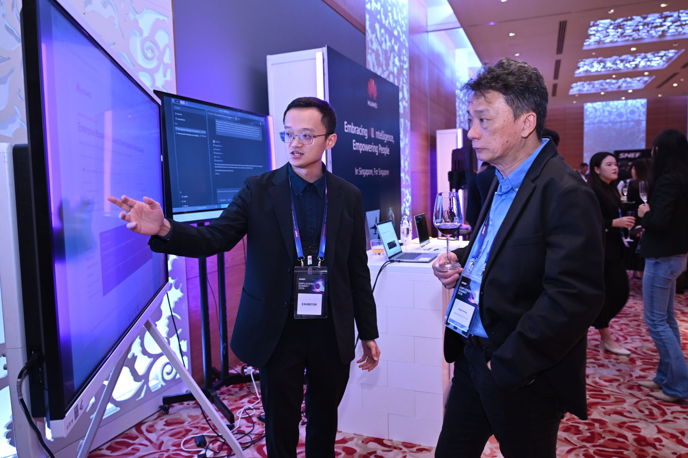

# SNEF 官方回顾：首届雇主峰会展区演示 AI

**2026 年 10 月 30 日**，新加坡全国雇主联合会（Singapore National Employers Federation, SNEF）举办首届雇主峰会（SNEF Employers' Summit 2026），主题为「Harnessing AI to drive business growth and amplify human potential」，超过 300 名企业领导人、资深人力资源从业者、劳资政伙伴及商会协会代表出席。SNEF 于次日在官方 LinkedIn 发布峰会回顾。

峰会展区共有 8 家机构展示 AI 在人力资源、劳动力与业务运营中的实际应用，华为是参展机构之一。我在华为展位（主题「Embracing All Intelligence, Empowering People · In Singapore, For Singapore」）的大屏前向来宾演示 AI 应用。上面这张照片拍摄于峰会交流环节：我正向来位与会代表讲解屏幕上演示的系统。

## 帖子信息

| 项目 | 内容 |
| --- | --- |
| 发布方 | Singapore National Employers Federation（SNEF）官方 LinkedIn |
| 帖子 | SNEF Employers' Summit 2026: Harnessing AI to drive business growth and amplify human potential |
| 发布时间 | 2026 年 10 月 31 日 |
| 短链 | https://lnkd.in/p/gNYWWW_q |
| 原帖 | https://www.linkedin.com/posts/singapore-national-employers-federation_snef-snefemployerssummit2026-ai-activity-7522115446737657856-5trl |

帖子要点：

- 主宾（Guest of Honour）为人力部代部长刘洁敏（Jasmin Lau），谈以信心、能力与协作驾驭 AI 转型
- SNEF 会长 Kuah Boon Wee 介绍 SNEF 支持雇主采用 AI 的举措，包括 AI—人事预配置方案（AI-HR pre-scoped solution）
- 新加坡电信集团 CEO Yuen Kuan Moon 分享企业 AI 转型与人才投入经验
- 由 Ninja Van CEO Chang Wen Lai 主持的座谈，探讨把 AI 采用转化为业务价值、同时建设人力能力
- 展区 8 家机构展示 AI 实际应用
- 关键结论：AI 采用应从明确的业务结果出发，辅以岗位重塑（job redesign）和对人的投入

同场活动另见[《联合早报》头版报道](../2026-10-30-zaobao-snef-ai-summit/)。

## 文件

| 文件 | 说明 |
| --- | --- |
| `snef-summit-booth-demo.jpg` | 峰会现场照片：在华为展位向与会代表演示 AI 应用（2048 × 1365，原图 `SNFE会议图片.jpg`） |

## 版权说明

帖子文字内容归 SNEF 所有，此处仅作个人履历存档与非商业引用，链接指向原帖。照片为本人提供的现场照片。如需在别处使用帖子内容，请先取得 SNEF 许可并注明出处。
