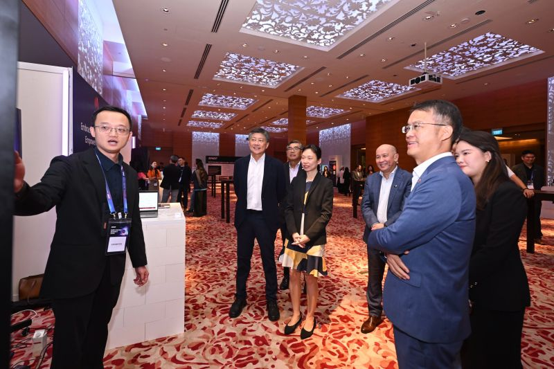

# NTUC 秘书长帖：华为新加坡获点名，本人展位演示照入选配图

**2026 年 11 月 3 日**，新加坡全国职工总会（National Trades Union Congress, NTUC）秘书长黄志明（Ng Chee Meng）在官方 LinkedIn 发帖，谈 AI 转型中「人」的角色：AI won't transform a company on its own. People will.（改变公司的不是 AI，是人。）

帖子回顾 SNEF 首届雇主峰会上两个 NTUC 公司培训委员会（Company Training Committees, CTC）伙伴的做法，并点名华为新加坡是 NTUC Lead Multipliers 之一——把数字化与 AI 方案同岗位重塑（job redesign）、技能提升（upskilling）相结合，帮助更多企业借力 CTC 计划。帖子的配图正是我在峰会华为展位向来宾演示 AI 的现场照片。

## 帖子信息

| 项目 | 内容 |
| --- | --- |
| 发布方 | 黄志明（Ng Chee Meng）· NTUC 秘书长 · 官方 LinkedIn |
| 帖子 | AI won't transform a company on its own. People will.（#EveryWorkerMatters） |
| 发布时间 | 2026 年 11 月 3 日 |
| 短链 | https://lnkd.in/p/gxKrx-nw |
| 原帖 | https://www.linkedin.com/posts/ng-chee-meng_everyworkermatters-activity-7523217916281053184-6vYK |

帖子要点：

- AI 本身不会改变一家公司，改变公司的是人；用对 AI 的雇主都从员工入手——重塑岗位、培养新技能、把员工带上转型之路
- 这正是 NTUC 公司培训委员会（CTC）的使命：帮助企业和员工一起向前
- 峰会上两个 CTC 案例获点名：
  - Singtel：自 2019 年起与新加坡电信业职工会（UTES）结为 CTC 伙伴，重塑岗位、培训员工与 AI 协同工作
  - 华为新加坡：NTUC Lead Multipliers 之一，帮助更多企业接入 CTC 计划，把数字化与 AI 方案同岗位重塑、技能提升搭配
- 技术迭代很快，员工必须跟上：掌握新岗位的技能、有成长的信心、公平分享收益，因为 #EveryWorkerMatters
- 呼吁雇主：拥抱 AI 的同时带上员工同行，与 NTUC 合作转型业务、为员工创造新机会

同场活动另见[《联合早报》头版报道](../2026-10-30-zaobao-snef-ai-summit/)与 [SNEF 官方回顾](../2026-10-31-snef-summit-recap/)。

## 文件

| 文件 | 说明 |
| --- | --- |
| `huawei-booth-demo.jpg` | 峰会现场照片：在华为展位向来宾演示 AI 应用，被黄志明帖选为配图（800 × 533，原图 `SNFE会议图片2.jpg`） |

## 版权说明

帖子文字内容归黄志明及 NTUC 所有，此处仅作个人履历存档与非商业引用，链接指向原帖。照片为本人提供的现场照片。如需在别处使用帖子内容，请先取得发布方许可并注明出处。
