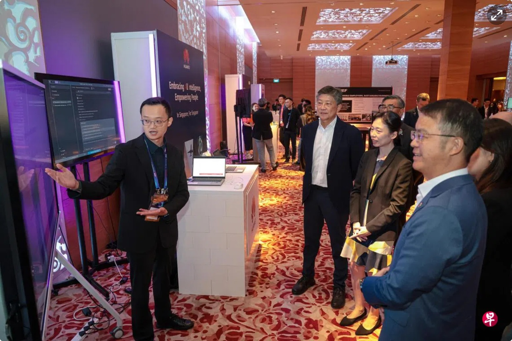
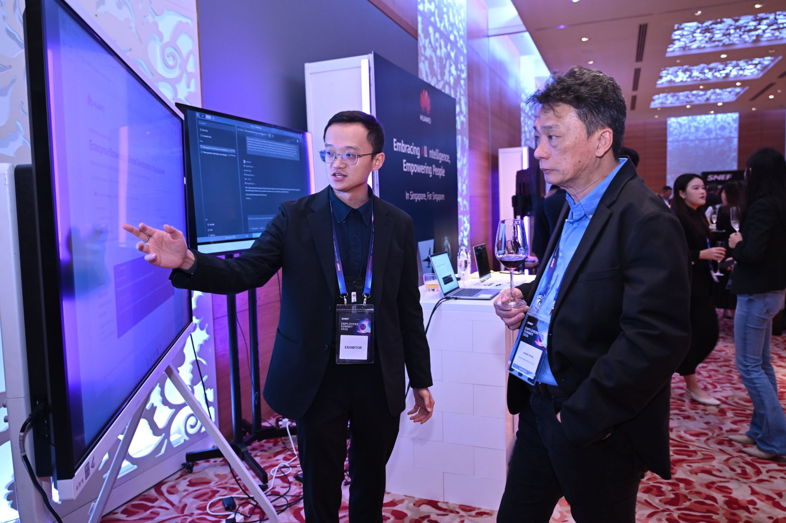
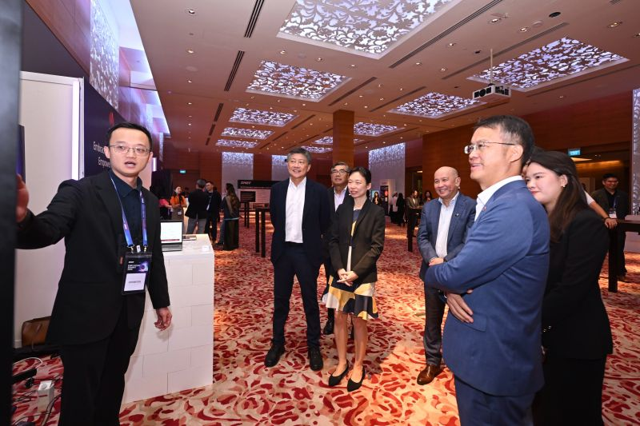

# Career Highlights

职业生涯里的高光时刻：见报、演讲、发布、获奖。每条一个目录，存原始素材和来龙去脉。

| 日期 | 事件 | 记录 |
| --- | --- | --- |
| 2026-10-30 | 《联合早报》头版报道——在新加坡全国雇主联合会首届雇主峰会上演示 AI，向人力部代部长刘洁敏讲解 | [查看](./2026-10-30-zaobao-snef-ai-summit/) |
| 2026-10-31 | SNEF 官方 LinkedIn 回顾——首届雇主峰会展区 8 家机构展示 AI 应用，在华为展位向来宾演示 | [查看](./2026-10-31-snef-summit-recap/) |
| 2026-11-03 | NTUC 秘书长黄志明 LinkedIn 帖——华为新加坡获点名 NTUC Lead Multiplier，本人展位演示照入选帖图 | [查看](./2026-11-03-ntuc-sg-post/) |

---

## 2026-10-30 · 联合早报

在 SNEF 首届雇主峰会的展区演示 AI 应用，被《联合早报》拍进报道头图。

**报道**：[刘洁敏：AI取代多少工作难预测 劳资政须携手应对冲击](https://www.zaobao.com.sg/news/singapore/story20261030-9923600) · 记者 李嘉敏 · 摄影 李冠卫 · 2026-10-30 22:41

[完整记录与素材 →](./2026-10-30-zaobao-snef-ai-summit/)

---

## 2026-10-31 · SNEF 官方回顾

SNEF 官方 LinkedIn 回顾首届雇主峰会：展区 8 家机构展示 AI 实际应用，我在华为展位的大屏前向来宾演示。

**帖子**：[SNEF Employers' Summit 2026: Harnessing AI to drive business growth and amplify human potential](https://lnkd.in/p/gNYWWW_q) · SNEF 官方 LinkedIn · 2026-10-31

[完整记录与素材 →](./2026-10-31-snef-summit-recap/)

---

## 2026-11-03 · NTUC 秘书长帖

NTUC 秘书长黄志明发帖谈 AI 转型「改变公司的不是 AI，是人」，点名华为新加坡为 NTUC Lead Multiplier，把数字化与 AI 方案同岗位重塑、技能提升结合——帖子配图正是我在峰会华为展位向来宾演示 AI 的照片。

**帖子**：[AI won't transform a company on its own. People will.](https://lnkd.in/p/gxKrx-nw) · 黄志明 · NTUC 秘书长 · 2026-11-03

[完整记录与素材 →](./2026-11-03-ntuc-sg-post/)

---

素材著作权归原媒体及作者所有，仅作个人履历存档，详见各目录内的版权说明。
